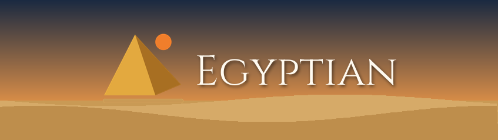

<p align="center">
  
</p>

# Egyptian — a fork based on Mayan EDMS® 4.x

**Egyptian** is a production fork of [Mayan EDMS](https://gitlab.com/mayan-edms/mayan-edms) 4.x,
maintained by [mypalace.ca](https://www.mypalace.ca/).
It ships bug fixes that have not yet been merged upstream, and serves as the base for a set of
commercial extensions built and used in production.

---

## Improvements over Mayan EDMS

What Egyptian adds to Mayan EDMS 4.12.2 or fixes in it. All of it is free and in this repository.
The list only keeps what still differs: fixes that Mayan EDMS has made since then are not listed.
The dated history of these changes, with the measurements behind them, is in
[CHANGELOG.md](CHANGELOG.md).

### File formats

- **Archives and compressed files:** ZIP and JAR files and, with libarchive, TAR, 7z, RAR, ISO, CAB,
  LHA, DEB, RPM, CPIO, XAR, WARC, gzip, bzip2, xz and zstd files get pages with a summary and the list
  of their entries, whose names go to the search. Nothing is extracted, and a decompression bomb gets
  a page that says where the listing stopped.
- **Audio files:** MP3, FLAC, M4A/AAC, Ogg Vorbis and Opus, WAV, AIFF and WMA files get a page with
  their tags, cover, waveform, duration, encoding and bit rate (FFmpeg).
- **DICOM files:** images through the modality LUT and the window of the file, one page per frame;
  structured reports and ECG; 12-bit and lossless JPEG read by decoders of this project.
- **Emails:** EML and Outlook `.msg` files on all their pages (WeasyPrint), with their headers, the
  names of their attachments and their embedded images. Their text is extracted at upload.
- **GPS tracks:** a GPX file gets a map, with its name, date, distance, duration and elevation gain.
  The map background comes from the tile server of the Itinéraires app when it is installed, else from
  OpenStreetMap. Set the `map_tile_url` entry of `CONVERTER_GRAPHICS_BACKEND_ARGUMENTS` to an empty
  value to draw the tracks with no request to the outside.
- **Raw photos:** CR2, CRW, NEF, ARW, DNG, ORF, RAF, RW2, PEF and X3F files developed at full
  resolution, with the white balance of the camera.
- **Drawings and models:** SVG and SVGZ (`rsvg-convert`, package `librsvg2-bin`), DXF and STL files,
  WMF and EMF drawings (LibreOffice).
- **Other files:** HEIF/HEIC images, videos (first frame, FFmpeg), DjVu (djvulibre, bundled files),
  EPUB (Calibre), Markdown (WeasyPrint), CSV, XML and Python scripts (LibreOffice), Photoshop files
  with layers (merged image).
- **Transparent images** are laid over a white background instead of turning black.
- **Types recognized from the content** when `file` gives a generic one: Office Open XML and
  OpenDocument archives, DICOM files with a TIFF header, raw photos built on TIFF, EMF drawings,
  Panasonic raw photos, emails.

### Large imports and processing

- PDF files stored as plain files are read in place to render their pages (pdftoppm) and extract
  their text (pdftotext), instead of being copied to the temporary directory for each page.
- Oversized PDF pages, such as captures of whole web pages, are rendered at the resolution that fits
  the pixel limit of Pillow instead of failing.
- Office documents and EPUB books are OCRed to the last page: the readers of a cached file wait for
  its lock (up to 30 s), and the retries of the OCR task on lock errors are spread out and more
  numerous. The task also retries on `FileNotFoundError`.
- The text of an office file takes one conversion, not one per page, and an EPUB book is converted
  once.
- A file that LibreOffice cannot convert no longer breaks the upload: the error is logged and the
  document gets its version.
- LibreOffice gets the extension of RTF files, and the intermediate PDF file is generated with the
  stored MIME type of the document file.
- NUL characters, which PostgreSQL rejects, are removed from file metadata, and the exiftool tags of
  RAR 5 archives and RPM packages are kept instead of logging an error.
- When an email or an Outlook message is split into documents, attachments of the same name stay
  distinct.

### Security and privacy

- **Encrypted storage:** AES-256-GCM (authenticated encryption) instead of AES-256-CBC, a random salt
  (32 bytes) and nonce (12 bytes) per file, PBKDF2 at 600,000 iterations instead of 100,000, and
  `cryptography` (PyCA) instead of `pycryptodome`.
- **OIDC:** cross-origin SSO logout, the missing parameters (token expiry, logout endpoint, id token
  storage), and a `ModelBackend` fallback when the provider is down.
- **Sentry:** no personal data (user, IP address, cookies) unless `send_default_pii` is enabled.
- **Emails, Markdown and XML files load nothing from elsewhere:** the first two only load the images
  they embed, and XML files are read as plain text.
- **SVG drawings** are rendered within 1.5 GB and 60 seconds, without loading remote images, and
  signatures are read from `data:` URLs only.

### Search

- Elasticsearch: partial search on text fields uses `match`, unless the value holds `*` or `?`, with a
  shared Point-in-Time for multi-scope queries and the page size capped to `SEARCH_RESULTS_LIMIT`.
- Deleted objects are tolerated by the index and deindex tasks, and the deletion tasks wait for the
  transaction to be committed, so that a deleted object does not come back in the index.
- Documents deleted from the trash leave the search.

### Interface

- The **System** menu opens the [documentation wiki](https://wiki.mypalace.ca/en/home) and a page of
  the Egyptian applications, installed or not, with the documentation, the forum and the store page of
  each one.
- The index templates link to the section of the wiki on creating an index.
- The list of the workers shows their memory limit in the right unit.

### Docker

- `docker compose` builds the image from this repository, with the tools of all these formats: see
  [Docker image](#docker-image).
- The health check of the Compose file works with `MAYAN_ALLOWED_HOSTS` and
  `MAYAN_GUNICORN_BIND_CONTAINER_IP_ONLY`.

### Dependencies

- `extract-msg` and `CairoSVG` are replaced by a reader of Outlook files written for this project on
  `olefile`, and by `rsvg-convert`.

---

## Extensions

The following applications extend Mayan EDMS with AI, workflow, and productivity features.
Access is granted per GitHub account via private repository; the free ones need an account
on the site.
All prices are in USD.

| Application | What it does | Price |
|---|---|---|
| [Approvals](https://egyptian-apps.mypalace.ca/apps/approvals/) | Document approval workflows with SLA and notifications | from $999 / yr |
| [ACL Explorer](https://egyptian-apps.mypalace.ca/apps/acl-explorer/) | Audit tool — see exactly what any user can access and why | $99 one-time |
| [Workflow UI](https://egyptian-apps.mypalace.ca/apps/workflow-ui/) | Visual drag-and-drop workflow editor | $499 one-time |
| [Document Q&A](https://egyptian-apps.mypalace.ca/apps/document-qa/) | Ask your documents in natural language — answers based on their text | $299 one-time |
| [Document Embedding](https://egyptian-apps.mypalace.ca/apps/document-embedding/) | Semantic search — find what you don't know how to search for | free with an account |
| [Document NER](https://egyptian-apps.mypalace.ca/apps/document-ner/) | Automatically extract persons, organizations, places and more from your documents | free with an account |
| [Autotag](https://egyptian-apps.mypalace.ca/apps/document-autotag/) | Zero-shot automatic tagging — your existing tags applied intelligently | free with an account |
| [Activity Report](https://egyptian-apps.mypalace.ca/apps/activity-report/) | Exportable audit reports: who did what, when, on which document | $149 one-time |
| [Barcode Extract](https://egyptian-apps.mypalace.ca/apps/image-barcode-extract/) | Automatically detect and index all barcodes in your documents | $149 one-time |
| [Document Health](https://egyptian-apps.mypalace.ca/apps/document-health/) | Quality dashboard — spot the documents that need attention | $149 one-time |
| [Version Diff](https://egyptian-apps.mypalace.ca/apps/document-version-diff/) | Compare two versions of a document — highlighted differences in one click | $149 one-time |
| [OCR Viewer](https://egyptian-apps.mypalace.ca/apps/ocr-viewer/) | Read, search and copy the OCR text of your scanned documents | $99 one-time |
| [Themes](https://egyptian-apps.mypalace.ca/apps/themes/) | 13 themes for Mayan EDMS 4.12, with the menus in the colors of the theme | $4.99 one-time |

Browse all apps and purchase access: **[egyptian-apps.mypalace.ca](https://egyptian-apps.mypalace.ca)**

---

## Docker image

No image of Egyptian is published: `docker compose` builds it from this repository at the first
start, without the extensions. It keeps the paths and the `MAYAN_*` variables of the Mayan EDMS
image: the Mayan EDMS Docker Compose file and `install-custom-apps.sh` work with it.

```bash
git clone https://github.com/germainm/egyptian.git
cd egyptian/docker
docker compose up --detach
```

Before the first start, edit `docker/.env`:

- Set your own passwords before real use.
- On a machine with fewer than 6 CPUs, set `MAYAN_DOCKER_CPU_LIMIT` to its number of CPUs, for
  example `MAYAN_DOCKER_CPU_LIMIT=4.0`. Otherwise Docker refuses to start the application:
  `Range of CPUs is from 0.01 to 4.00`.

The image has the tools of all the file formats added to the converter: FFmpeg (videos, audio
files), djvulibre (DjVu), Calibre (EPUB), libarchive (archives), WeasyPrint (EML, Markdown)
librsvg (SVG) and the Python libraries of the RAW photo, DXF, STL, DICOM (with pyjpegls and
pylibjpeg-openjpeg), HEIF/HEIC
and archive formats. The GitHub Actions workflow `Docker image`, run by hand, builds it with
Docker Compose, starts it and turns one file of 11 formats into pages. It takes 7 minutes to build
and start on a GitHub runner with 4 CPUs.

### Building the image by hand

From the root of the repository:

```bash
DOCKER_BUILDKIT=1 docker build --tag egyptian:s4.12 --file docker/Dockerfile .
cd docker
docker compose up --detach
```

Docker Compose uses this image and does not build it again. The Dockerfile needs BuildKit: without
`DOCKER_BUILDKIT=1`, Docker 20.10, the version in Debian 12, stops with
`the --mount option requires BuildKit`.

The build took 16 minutes on a virtual machine with 4 vCPUs and 16 GB of memory, with Docker
20.10.24 and Docker Compose 2.32.4. With its cache and the images of the other services, it used
about 6 GB of disk.

To give the image another name, build it with that name:

```bash
DOCKER_BUILDKIT=1 docker build --tag my-egyptian:1.0 --file docker/Dockerfile .
```

and set the name in `docker/.env`:

```bash
MAYAN_DOCKER_IMAGE_NAME=my-egyptian
MAYAN_DOCKER_IMAGE_TAG=1.0
```

To use an image from your own registry, set its name the same way and add
`MAYAN_DOCKER_IMAGE_PULL_POLICY=missing`. Without this line, Docker Compose does not pull the image:
it builds one from the repository under that name.

To update, from the `docker` directory:

```bash
git stash
git pull
git stash pop
docker compose build
docker compose up --detach
```

`git stash` keeps your changes to `docker/.env` aside during the update. `docker compose build` did
not need `DOCKER_BUILDKIT=1` with these versions.

To regenerate the files of the image after a change to the workers, the queues or
`mayan/literals.py`, see `docker/generer.py`.

---

## Tests

The renderers of the formats added to the converter and the refinement of the MIME types have
unit tests (216): archives and compressed files (ZIP, JAR, TAR, gzip, RAR headers, RPM headers,
encryption, decompression bombs, pages and search text), GPS tracks, DICOM images, 12-bit and
lossless JPEG, audio files, SVG drawings and signatures, emails and Markdown files without remote resources, the text of the emails,
the Outlook `.msg` files, transparency, and the content-based MIME types. They need no database and no network: their
files are built in memory or come with pydicom. Run them from a clone of this repository, with
the Python of an Egyptian installation. The Docker image does not contain them.

```bash
MAYAN_MEDIA_ROOT=$(mktemp -d) python3 manage.py test mayan.apps.converter mayan.apps.document_parsing mayan.apps.mime_types mayan.apps.signature_captures mayan.apps.storage
```

The tests that need a tool or a library that is not installed (FFmpeg, libarchive-c,
WeasyPrint, rsvg-convert, pydicom, pyjpegls, pylibjpeg-openjpeg, gpxpy) are skipped. The Egyptian extensions have their own tests in their
repositories.

---

## Documentation

**[wiki.mypalace.ca](https://wiki.mypalace.ca/en/home)** — installation, operations, reference
guides, development, and one page per Egyptian application, in English and in French.

---

## Community forum

Questions, feedback, and discussion about Egyptian and its extensions:

**[egyptian-apps.mypalace.ca/forum/](https://egyptian-apps.mypalace.ca/forum/)**

---

## About Mayan EDMS

Mayan EDMS is a free, open source document management system written in Python / Django.
It provides document storage, OCR, workflows, metadata, access control, and much more,
and is designed for self-hosted enterprise deployments.

- **Source code**: [gitlab.com/mayan-edms/mayan-edms](https://gitlab.com/mayan-edms/mayan-edms)
- **Documentation**: [docs.mayan-edms.com](https://docs.mayan-edms.com)
- **License**: GNU General Public License, version 2.0 (GPL-2.0-only)

Egyptian tracks the Mayan EDMS 4.x branch. Changes in this fork that are generic enough
are submitted upstream when possible.

"Mayan EDMS" is a registered trademark of Roberto Rosario. Egyptian and its extensions are
not affiliated with, or endorsed by, the Mayan EDMS project or its trademark holder.
